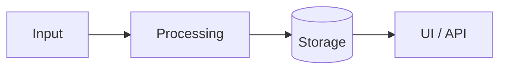

# Project Name

> One sentence: what it does and who it's for.

<!-- Badges: replace OWNER/REPO. Delete any that don't apply. -->


**Live demo:** https://... · **Video (60 sec):** https://...


## Why I built it
2-3 sentences. The problem, and why existing options weren't good enough.

## What it does
- Feature 1 (the most impressive thing first)
- Feature 2
- Feature 3

## Results
Numbers a reader can check: rows processed, latency, accuracy, users, test coverage, cost per run.

## How it works
Short architecture explanation plus a diagram (`docs/architecture.png` or a Mermaid block).



## Tech stack
| Layer | Tech |
|---|---|
| Frontend | |
| Backend | |
| Data | |
| Infra / CI | |

## Run it locally
```bash
git clone https://github.com/MdChehab/REPO.git
cd REPO
cp .env.example .env   # fill in values
# install + run commands here
```

## Tests
```bash
# test command here
```

## Decisions and tradeoffs
What I chose, what I didn't, and why. This is the section interviewers ask about.

## What's next
- [ ] Next improvement
- [ ] Stretch goal

## License
MIT - see [LICENSE](LICENSE).
